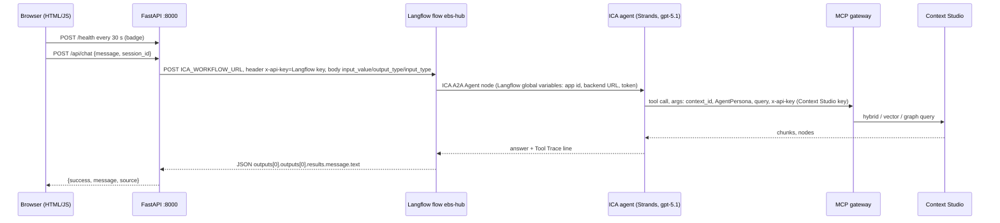
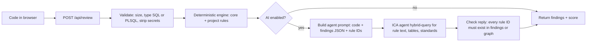
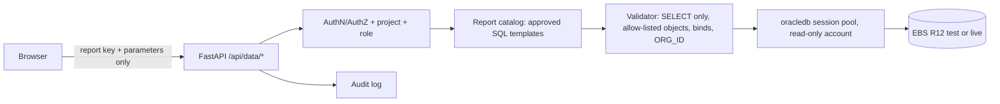

# IBM Oracle EBS Intelligence & Development Accelerator
## Repository analysis and phased implementation plan

**Status:** Plan only. No existing code was changed to produce this document.
**Basis:** Every statement below was read from the source in this repository. Anything not opened is marked **(not reviewed)**. Nothing is called working unless a code path shows it.

---

## 0. Target positioning

| Pillar | What it covers | Built on (today) | Main gap |
|---|---|---|---|
| **EBS Intelligence** | Enterprise knowledge, business questions, reports, contextual answers | Chat tab, ICA agent, Context Studio graph | Reports are sample data; chat depends on one prompt-held key |
| **EBS Development** | SQL, PL/SQL, code review, optimisation, documentation | SQL Advisor, Code Review (27 checks), Formatter, Doc Generator, SQL Lab | Rules are hard-coded in JS; no PL/SQL rules; no AI review |
| **EBS Data Intelligence** | Live database connectivity, reporting, analysis | Data Connect (file import) | No database connectivity exists |
| **Team Accelerator** | Reusable project configs, knowledge, onboarding | `ica-schema/`, `appstudio/`, `docs/`, secrets scripts | Project names, context ID and branding are hard-coded |

---

## 1. Feature inventory (verified against code)

Legend: **F** = fully functional, **P** = partially functional, **M** = mock/demo only, **N** = not implemented.

| Area | Status | Evidence |
|---|---|---|
| Login and roles | **P** | `rlDoLogin()` (`ebs-reports.js` ~110) compares the typed password with `window.EBS_CREDENTIALS`, loaded from `ebs-credentials.js`. Role is kept in `sessionStorage('ebs_role')`. Everything is client-side. |
| Chat, ICA path | **F** | `sendChatMessage` is wrapped in `ebs-ica-integration.js` (~141). Non-report questions go to `POST /api/chat`, then Langflow, then the agent. Verified live in this project (Playground and page returned COMP-008 text). |
| Chat, local path | **M** | `generateChatResponse()` (~2026) is a keyword-to-report table. Report intents (`_isReportIntent`) and ICA-offline both use it. |
| Reports tab (27 reports) | **M** | `loadReport()` (~927) reads `window.REPORT_DATA[key]`. `ebs-reports-data.js` builds rows from constant lists and `rnd()` (`Math.random`), so data changes on every page load. |
| Report export (CSV/Excel/PDF), chart, filters, paging | **F** on sample data | `downloadReport`, `toggleChart`, `changePage` exist and operate on `APP.allRows`. |
| Custom/imported/deleted reports | **P** | Held in in-memory objects (`IMPORTED_REPORTS`, `DELETE_REQUESTS`, `RECYCLE_BIN`, `DELETED_REPORTS`). Lost on refresh. No `localStorage` use found. |
| SQL Advisor, Performance | **P** | `performSQLAnalysis` (~2471) is rule-based. The cost value is an indicative score, not an Oracle EXPLAIN PLAN. |
| SQL Advisor, Code Review | **F** (local) | `performCodeReview` (~4080), 27 checks, no LLM, no backend call. |
| SQL Advisor, Formatter | **F** | `formatSQL` (~4789) and helpers. Tested in Node in an earlier session; browser result not confirmed. |
| Doc Generator | **F** | `generateDocument` (~2808), `downloadDoc` (~3803). Produces HTML following the Word template structure. Templates are static files in `docs/templates/`. It does not fill the `.doc` files. |
| SQL Lab | **F** (static content) | `window.EBS_SQL_LIBRARY` in `ebs-sqllib-data.js`. Content library only. |
| EBS Academy | **P** | Content in `window.EBS_ACADEMY`. The "assistant" (`sendAcademyAsstMessage` ~6766, `generateAsstResponse` ~6796) is a keyword responder with a 400 ms `setTimeout`. It does not call ICA. |
| Data Connect, file import and mapping | **F** | `_dcLoadFile`, `dcAutoMap`, `dcApplyMapping`, `dcExportPreview`, `dcPushToReports` (~7763-8240). |
| Data Connect, "DB query" | **M** | `dcRunDbQuery` (~8267) maps SQL text to a sample report via `TABLE_MAP`, then fabricates cell values (`SIM-nnnn`, random amounts, ~8472-8484). |
| Data Connect, "Live DB" | **N** | `dcTestConnection` (~8532) only tests whether a typed proxy URL answers. `dcRunLiveQuery` (~8577) POSTs `{sql, host, port, sid, user, pass}` to that URL. No such proxy exists in the repo. |
| Hidden tabs (`tab-reqanalyzer`, `tab-reqstudio`, `tab-ica`) | **(not reviewed)** | Buttons carry `data-hidden="true"` and are never shown (`_applyRoleTabVisibility`). |
| Backend `/health` | **F** | Used by the badge. |
| Backend `/api/chat` | **F** | Langflow call, retry, error mapping. |
| Backend `/api/sql_advisor`, `/api/academy`, `/api/intelligence`, `/api/chat/enrich` | **Unused** | No call from the page. Only `/health` and `/api/chat` appear in `ebs-ica-integration.js`. |
| Automated tests, CI, Dockerfile | **N** | No test files, workflows or container files found. Only `test-ica.bat` (manual curl). |

### Duplicated and inconsistent logic found
1. Module/table/report/rule lookup tables exist twice in Python: `chat.py` (`MODULE_TABLES`, `MODULE_REPORTS`, `MODULE_RULES`, `detect_module`) and `services/ica_workflow_service.py`.
2. `compliance_checker.py` has **14** rules, but its docstring says 28. It uses IDs `RULE_001`..`RULE_024`, where `RULE_003` means SELECT *. In the knowledge graph, `RULE_003` means PRIMARY_FLAG on assignments. **Same ID, different meaning.**
3. The front-end Code Review has 27 numbered checks with no rule IDs. The graph uses `COMP-001`..`COMP-010` and `RULE_nnn`. Three naming schemes exist for one concept.
4. `fetch_mcp_context()` in `chat.py` only runs when `ICA_AGENT_MODE=false`. It is legacy.
5. `ICA_BACKEND_URL = 'http://localhost:8000'` is hard-coded in `ebs-ica-integration.js` line 3.

---

## 2. Tab, button, function and API trace

| Tab | Visible to | Main controls (HTML) | JS function(s) | Backend API |
|---|---|---|---|---|
| Login | all | `rlSelectOpt`, `rlGoToLogin`, `rlDoLogin`, `rlLogout` | `ebs-reports.js` ~55-300 | none |
| 1 Chat | Employee, Technical | `sendChatMessage`, `injectQuery`, `clearChat`, `downloadChatReport`, `downloadCurrentReport`, `openRecentSession` | patched in `ebs-ica-integration.js`; fallback `generateChatResponse` | `POST /api/chat` |
| 2 EBS Reports | Employee, Technical | `selectModule`, `loadReport`, `toggleChart`, `toggleSQL`, `copySQL`, `downloadReport`, `resetFilters`, `changePage`, `deleteCurrentReport`, `openNewCustomReportDialog` | `ebs-reports.js` ~913-1900 | none |
| 3 SQL Advisor | Technical | `loadSampleSQL`, `analyzeSQL`, `compareSQL`, `copyOptimizedSQL`; `performCodeReview`, `loadSampleReviewSQL`, `loadSQLToReview`; `formatSQL`, `loadSampleSQLToFormatter` | `ebs-reports.js` | none (`/api/sql_advisor` exists, unused) |
| 4 Doc Generator | Technical | `generateDocument`, `downloadDoc` | `ebs-reports.js` ~2808, ~3803 | none |
| 5 SQL Lab | Technical | `sqlLabBackToWelcome` and library navigation | `ebs-reports.js` ~5917+, data in `ebs-sqllib-data.js` | none |
| 6 EBS Academy | Technical | `renderAcademyModuleTree`, `askAcademyAssistant`, `sendAcademyAsstMessage` | `ebs-reports.js` ~6008-7450, data in `ebs-academy-data.js` | none (`/api/academy` unused) |
| 7 Data Connect | Employee, Technical | `dcDrop`, `dcFileSelected`, `dcAutoMap`, `dcApplyMapping`, `dcPushToReports`, `dcRunDbQuery`, `dcTestConnection`, `dcRunLiveQuery` | `ebs-reports.js` ~7706-8690 | none (user-typed proxy URL) |
| Hidden: Req Analyzer, Req Studio, ICA Knowledge | nobody | `switchTab(...)` | `ebs-req-analyzer.js`, `ebs-requirements-studio.js` | **(not reviewed)** |

**Unused backend endpoints:** `/api/sql_advisor`, `/api/academy`, `/api/intelligence`, `/api/chat/enrich`.
**Missing integrations:** AI Code Review, Academy assistant to ICA, Reports to database, Data Connect to database, Doc Generator to knowledge graph, SQL Lab to graph.

---

## 3. End-to-end request and response flow (Chat, the only AI path)



**Routing in the browser** (`ebs-ica-integration.js` ~141-160): if ICA is not "online" or the text matches `_isReportIntent`, the original local `sendChatMessage` runs. Otherwise `icaWorkflowChat` is used. If it returns `null` or fewer than 10 characters, the bubble is removed and the local answer is used.

**Three separate credentials are involved**

| Hop | Credential | Where it lives |
|---|---|---|
| Browser to FastAPI | none | n/a |
| FastAPI to Langflow | Langflow API key (`ICA_API_KEY`) | `backend/.env` (git-ignored) |
| Langflow to ICA backend | `ICAAAS_BACKEND_TOKEN` | Langflow global variable |
| Agent to Context Studio | Context Studio key | **Inside the agent instruction text** in Agent Studio |

**Error handling in `chat.py`**

| Condition | Result `source` | Retry |
|---|---|---|
| Empty message | `error` | no |
| `ICA_WORKFLOW_URL` or key missing | `config_error` | no |
| HTTP 401/403 | `ica_auth_error` | no |
| HTTP 5xx | `ica_server_error` | yes, 3 tries, 1 s then 2 s |
| Timeout (30 s) | `ica_timeout` | yes |
| Connect error | `ica_connection_error` | no |
| 200 and text starts "The agent request failed" | `ica_agent_error` | no |
| 200 with any other text | `ica_live`, `success: true` | n/a |

**Known weakness:** a 200 reply whose text says "Invalid token" or "knowledge graph not accessible" is still `success: true, source: ica_live`. This was seen in `test-ica.bat` tests 2-5. The page cannot tell a real answer from an agent apology. The plan (section 5) fixes this with a structured tool-status field, not text matching.


---

## 4. How the 27 Code Review checks work today

**Where they live:** one function, `performCodeReview()` in `ebs-reports.js` (line ~4080 to ~4530). Each check is an inline `if (...) reviews.push({...})` block. There is no rule table, no rule IDs and no external file.

**Flow:** read SQL from `#codeReviewInput` (fallback `#sqlInputArea`), set `S` (original) and `U` (upper case), run every block, add "good practice" notes, sort by severity, compute the score, render HTML.

**Finding shape:** `{ sev, cat, title, detail, before, after }`.

**Score:** `100 - 20 x critical - 10 x major - 5 x minor`, floor 0. Info and good items do not count (lines ~4539-4542).

| # | Check | Severity | | # | Check | Severity |
|---|---|---|---|---|---|---|
| 1 | No SQL comments | major | | 15 | LIKE leading wildcard | major |
| 2 | SELECT * | critical | | 16 | NOT IN with subquery | critical |
| 3 | Correlated subquery in SELECT list | critical | | 17 | IN list over 1000 values | major |
| 4 | Implicit comma joins | major | | 18 | Hard-coded literals, no binds | major |
| 5 | Multi-org `_ALL` table without ORG_ID (13 tables, one finding per table) | critical | | 19 | SYSDATE compare without TRUNC | minor |
| 6 | DateTrack table without effective dates (8 tables) | critical | | 20 | ROWNUM before ORDER BY | critical |
| 7 | Function wrapping an indexed column | major | | 21 | Missing PRIMARY_FLAG on assignments | critical |
| 8 | NVL vs COALESCE | minor | | 22 | GL_CODE_COMBINATIONS flags | minor |
| 9 | ORDER BY without row limit | minor | | 23 | AP_INVOICES_ALL cancelled date | minor |
| 10 | FOR UPDATE in a report | major | | 24 | FND_LOOKUPS vs FND_LOOKUP_VALUES_VL | info |
| 11 | Missing optimizer hints on big joins | info | | 25 | iExpense SOURCE filter | major |
| 12 | NLS-dependent date literal | major | | 26 | MERGE without WHERE on UPDATE | major |
| 13 | DISTINCT used as a crutch | minor | | 27 | EXECUTE IMMEDIATE without binds | critical |
| 14 | Implicit number-to-string conversion | major | | | | |

Totals: 8 critical, 11 major, 6 minor, 2 info (counted from the source). Severities for checks 7-13 and 14-27 were read from each block's `sev:` value.

**Limits that matter for design (all verified):**
- Detection is regex and `includes()` on the raw text. It does not parse SQL. Comments and string literals are not stripped before most tests, so a table name inside a comment can trigger a finding.
- `ORG_ID` or `MO_GLOBAL` anywhere in the text satisfies the multi-org check for every table, even if it only filters one of them.
- The table lists (13 multi-org, 8 DateTrack) are arrays inside the function.
- PL/SQL constructs (cursors in loops, `WHEN OTHERS`, missing `COMMIT`/`ROLLBACK` handling, `DBMS_OUTPUT` left in, autonomous transactions, bulk collect limits) are not checked, except check 27.

### 4.1 Target design: a rule pack another project can change without touching the engine

```
rules/
  core/               # shared by every project, versioned, read-only for projects
    manifest.json
    sql-rules.json
    plsql-rules.json
  projects/
    cook-county/
      manifest.json   # extends: ["core"]
      overrides.json  # disable / change severity / add tables
      custom-rules.json
```

**Rule record (JSON, language-neutral so JS and Python share one file):**

```json
{
  "id": "COMP-002",
  "legacyCheck": 2,
  "title": "SELECT * — never use wildcard column selection",
  "category": "Best Practice",
  "severity": "critical",
  "appliesTo": ["sql", "plsql"],
  "detector": { "type": "regex", "pattern": "SELECT\\s+\\*", "flags": "i", "stripComments": true, "stripStrings": true },
  "detail": "…", "before": "…", "after": "…",
  "knowledgeNode": "COMP-008"
}
```

**Detector types** (a small, closed set, so projects add rules as data, not code): `regex`, `tableWithoutPredicate` (tables list + required tokens), `tokenCount`, `custom` (named function registered in the engine, allow-listed).

**Project overrides:** `{ "disable": ["COMP-011"], "severity": { "COMP-009": "major" }, "tables": { "multiOrg": ["XX_CUSTOM_ALL"] }, "add": [ … ] }`.

**Engine:** one module (`rule-engine.js` in the browser, `rule_engine.py` in Python) loads `core` plus the active project pack, merges overrides, runs detectors, returns the same finding shape. The JS engine keeps today's UI. The Python engine is used for the AI pipeline (section 5) and for tests, so the **same rule file is the single source of truth** for both.

**Backwards compatibility:** first release ships `core/sql-rules.json` with the 27 existing checks migrated one-for-one. A regression test runs old `performCodeReview()` and new engine on the same corpus and fails on any difference in rule hit, severity or score. Only then is the inline code switched over.

**ID reconciliation (required):** map the three naming schemes (check numbers, `COMP-nnn`/`RULE_nnn` in the graph, `RULE_nnn` in `compliance_checker.py`) to one ID per rule, and fix the `RULE_003` clash.

---

## 5. Automated AI-powered SQL and PL/SQL review

### 5.1 Principle
The rule engine decides **what is wrong** (deterministic, repeatable). The ICA agent explains **why, in this project's words**, using the knowledge graph. The LLM never overrides a rule result, and never invents a rule ID.

### 5.2 Pipeline



### 5.3 New / changed code

| Item | Type | Detail |
|---|---|---|
| `backend/app/services/rule_engine.py` | new | Loads rule packs, runs detectors, returns findings and score. Replaces the 14-rule `compliance_checker.py` (kept until parity test passes). |
| `backend/app/routes/review.py` | new | `POST /api/review` body: `{code, language: "sql"|"plsql", project, ai: bool}`. Returns `{findings[], score, ai: {summary, explanations[], status}}`. |
| `backend/app/services/ai_review.py` | new | Builds the prompt, calls the existing Langflow URL through the same `httpx` code path as `chat.py` (extract that call into a shared `ica_client.py` first). |
| Agent instruction | edit | Add a "Code review mode" paragraph: input is code plus findings JSON; reply is JSON only; cite only rule IDs present in the input or returned by a tool. |
| `ebs-reports.js` | edit | `performCodeReview()` calls `/api/review`. If the backend is down, fall back to the local engine. Add an "AI explanation" panel that is filled when the call returns and is clearly labelled as AI. |
| `ebs-ica-integration.js` | edit | Add `icaService.review(code, language)`; read the backend URL from config, not a constant. |
| `rules/` | new | Rule packs (section 4.1), including a first PL/SQL set. |

### 5.4 Guard rails
1. **Structured status:** `ai.status` is `ok`, `tool_error`, `empty`, `timeout` or `disabled`. The UI shows the deterministic result regardless, plus an honest AI status line. Detection of tool failure must use the agent's structured output (tool trace field), not the wording of the reply.
2. **Citation check:** after the agent replies, the backend drops any explanation whose rule ID is not in the findings or the project pack.
3. **Size and privacy:** cap input (for example 50 KB), strip anything that looks like a credential before sending, never send query results, only code.
4. **Cost and latency:** the AI step is optional and asynchronous. The deterministic score appears first.
5. **Audit:** log request id, user role, project, rule IDs hit, AI status. Do not log the code body unless the project policy allows it.

### 5.5 PL/SQL starter rules (to add as data)
`WHEN OTHERS` without re-raise; `COMMIT` inside a loop; cursor `FETCH` row by row without `BULK COLLECT ... LIMIT`; `DBMS_OUTPUT` left in; dynamic SQL built by concatenation; missing `FND_FILE`/`FND_MESSAGE` logging in concurrent programs; unqualified `SELECT INTO` without `NO_DATA_FOUND`/`TOO_MANY_ROWS` handling; hard-coded `ORG_ID`; missing `mo_global.set_policy_context`; `AUTONOMOUS_TRANSACTION` without a justification comment.

---

## 6. Secure Oracle EBS R12 database connectivity (python-oracledb)

**Today: none.** The page cannot reach a database, and the Live DB form sends a password from the browser. That path is removed in the design below.

### 6.1 Architecture



**Key decision:** the browser sends a **report key and parameters**, not raw SQL. The server holds the SQL (from the report catalog). Free-form SQL is limited to a separate, technical-role, row-capped "explorer" endpoint that is off by default.

### 6.2 Controls

| Control | Design |
|---|---|
| Driver | `oracledb` (thin mode, no Oracle client install). Pin the current stable version in `requirements.txt` after checking its release date and licence (Apache 2.0 / UPL). |
| Credentials | Service account name, DSN and password only in environment variables or a vault (IBM Key Protect / HashiCorp Vault). Never in the repo, the browser or logs. |
| Account | Dedicated read-only schema or user with `SELECT` on a named list of `APPS` views or synonyms, no `PUBLIC` grants, no DDL/DML, no `EXECUTE` except an approved context-setting procedure. |
| Pool | `oracledb.create_pool_async` with `min=1, max=N`, `getmode=POOL_GETMODE_TIMEDWAIT`, `wait_timeout`, `max_lifetime_session`, `ping_interval`. One pool per data source, created at startup, closed on shutdown. |
| Session | Per request: acquire, run, release. Set `client_identifier` and `module/action` for traceability. Set `call_timeout` (for example 30 s). |
| MOAC / ORG_ID | At acquire time call `mo_global.set_policy_context('S', :org_id)` (single OU) or `mo_global.init('PO')` + `mo_global.set_policy_context('M', NULL)` for multi-org access, using only OU IDs the signed-in user is entitled to. Query `_ALL` tables through the MO views (`AP_INVOICES` etc.) or add an explicit `org_id IN (:orgs)` predicate. Reject a request that names an OU outside the user's grant. |
| Query validation | Parse with a real SQL parser (for example `sqlglot`), not regex. Allow a single `SELECT`/`WITH`. Reject DML/DDL, `;` chains, `DBMS_*`/`UTL_*` calls, database links, `FOR UPDATE`, `EXECUTE IMMEDIATE`. Require bind variables for all values. Check every referenced object against the allow-list. |
| Limits | `fetch_arraysize`, hard row cap (for example 10 000), response size cap, per-user rate limit. |
| Errors | Return a generic message and an error id. Log the ORA code and statement server-side only. |
| Audit | Append-only record: time, user, role, project, data source, report key, parameter names (not values for sensitive fields), row count, duration, outcome. Retain at least 90 days per the security rules. |
| Transport | TLS 1.2+ to the database (Oracle native encryption or TCPS) and to the API. |
| Data protection | Column-level masking list per project; sensitive columns (bank account, tax id, national id, salary) are masked unless the role and data source allow it. |

### 6.3 New code
`backend/app/db/pool.py`, `db/session.py` (MOAC context), `db/validator.py`, `db/audit.py`, `routes/data.py` (`GET /api/data/sources`, `POST /api/data/report/{key}`, `POST /api/data/test-connection`), `reports/catalog/*.json` (key, title, module, SQL template, parameters, columns, required OU handling, masked columns).

**Open dependencies (cannot be decided from code):** database version and DSN, whether the EBS instance allows a non-APPS read account, which OUs each role may see, whether masking is done in the database or in this application. These need the DBA and security teams.

---

## 7. Connecting the Reports tab and Data Connect to real data

### 7.1 Sample-data dependencies that must be replaced or abstracted

| Dependency | Where | Replace with |
|---|---|---|
| `window.REPORT_DATA.*` (27 reports) built with `rnd()` | `ebs-reports-data.js` | A data-source adapter (section 8). The sample generator stays as the `demo` source. |
| `window.REPORT_META`, `window.REPORT_LOV` | `ebs-reports-data.js` ~990-1010 | Served by `GET /api/reports/catalog`. |
| `loadReport()` reads `REPORT_DATA[key]` directly, uses `data.rows` | `ebs-reports.js` ~939-975 | `await DataSource.getReport(key, params)`. |
| Hard-coded sidebar `loadReport('...')` items | `oracle-ebs-intelligence-hub.html` ~523-611 | Built from the catalog response. |
| `APP.allRows`, in-page filter, paging, chart | `ebs-reports.js` | Keep, but paging and filtering move to the server for large result sets. |
| `generateChatResponse` and `injectQuery` buttons (report intent) | `ebs-reports.js` ~2026, html ~333-340 | Same adapter, so chat shows real rows when the source is live. |
| `dcRunDbQuery` `TABLE_MAP` and fabricated cell values | `ebs-reports.js` ~8267-8490 | Call `POST /api/data/query` (explorer endpoint) or remove from non-demo modes. |
| `dcRunLiveQuery` sending host/user/password from the browser | `ebs-reports.js` ~8577 | Remove the password field. Select a named data source; the server holds credentials. |
| `ICA_BACKEND_URL` constant | `ebs-ica-integration.js` line 3 | `config.js` value. |
| `backend/app/routes/chat.py` and `ica_workflow_service.py` module/report/rule dictionaries | Python | Generated from the catalog and the graph; delete the duplicate. |
| Academy and SQL Lab content | `ebs-academy-data.js`, `ebs-sqllib-data.js` | Can stay as static content, but should be per-project packs (section 9). |
| Imported/custom/deleted report registries | in-memory JS objects | Server-side per-user store, or at least `localStorage`, if persistence is required. |

### 7.2 Reports tab flow (target)
1. On login the page calls `GET /api/data/sources` and shows the allowed source (Demo / Test / Live) in the header.
2. `GET /api/reports/catalog` builds the sidebar.
3. Selecting a report shows its parameters from the catalog (OU, period, supplier).
4. `POST /api/data/report/{key}` returns `{columns, rows, total, truncated}` from the active source.
5. Export uses the same response; large exports are streamed by the server.

### 7.3 Data Connect flow (target)
- **File import** stays as it is (it works and needs no database).
- **Database import** becomes: choose a named data source and a catalog report, or (technical role, if enabled) an explorer query. The returned `{columns, rows}` feeds the existing mapping code at the point where `DC.rawHeaders`/`DC.rawRows` are set (`dcRunLiveQuery` ~8611-8618 already has that exact shape). So the mapping, preview and push-to-reports code does not change.
- The 100 column-mapping rules in the graph can be queried through the agent to suggest mappings. This is an optional enhancement.

---

## 8. Demo / Test / Live data-source framework

### 8.1 Concept
One interface, three implementations, chosen by configuration. Application code asks for "report X with parameters Y" and never knows which source answered.

| Mode | Source | Data | Who may use it |
|---|---|---|---|
| `demo` | In-repo generator (today's `ebs-reports-data.js`, seeded so results are stable) | Synthetic | everyone, no database |
| `test` | Oracle test or cloned instance, masked | Masked copy | technical + approved employees |
| `live` | Oracle production, read-only | Real | only roles named in policy, with audit |

### 8.2 Configuration (no code change to switch)

`config/datasources.yaml` (tracked, no secrets):
```yaml
default: demo
sources:
  demo: { type: sample, seed: 42 }
  test: { type: oracle, dsn_env: EBS_TEST_DSN, user_env: EBS_TEST_USER, password_env: EBS_TEST_PASSWORD,
          masking: cook-county-test, allowed_roles: [technical, employee], max_rows: 5000 }
  live: { type: oracle, dsn_env: EBS_LIVE_DSN, user_env: EBS_LIVE_USER, password_env: EBS_LIVE_PASSWORD,
          masking: none, allowed_roles: [technical], max_rows: 10000, require_reason: true }
```
The active source is chosen by `EBS_DATA_MODE` (environment variable) per deployment, and may be narrowed per user by policy. Passwords come only from environment variables or the vault.

### 8.3 Code structure
```
backend/app/data/
  base.py            # DataSource interface: list_reports, get_report, run_query, health
  sample_source.py   # moves REPORT_DATA generation to Python (seeded)
  oracle_source.py   # uses db/ pool, validator, MOAC, masking
  masking.py         # rule-driven masking: hash, partial, fake, null
  registry.py        # reads datasources.yaml, enforces allowed_roles, returns the source
```
Front end: `data-source.js` with `DataSource.getReport()` that calls the backend. If the backend is unreachable and the mode is `demo`, it falls back to the existing in-page sample data, so the standalone demo keeps working.

### 8.4 Safeguards
- A visible banner shows the active mode (green demo, amber test, red live).
- Live mode requires a reason string, and logs it.
- Switching to `live` needs a deploy-time change, not a user click.
- Masking is applied in the server before data leaves the process.


---

## 9. Reusable multi-project configuration framework

### 9.1 What is project-specific today (hard-coded)
Context ID `ctx_b0ecd6cee49f` (in `backend/.env`, agent instructions, docs); persona `OracleEBSIntelligenceAgent`; "Cook County AMS Project" in the HTML (login panel, header chip) and docs; operating units CCP/CCH/CCF in `ebs-reports-data.js`; custom report names; Word templates `CCG-DO080...` and `CCG ERP FS...`; `ICA_BACKEND_URL`; sample suppliers and employees.

### 9.2 Project pack layout
```
projects/
  _template/                      # copy this to start a new team
  cook-county-ams/
    project.yaml                  # name, display title, branding, default data mode, enabled tabs
    ica.yaml                      # context id, persona, agent id, flow id (no keys)
    datasources.yaml              # demo/test/live definitions (env var names only)
    rules/                        # overrides + custom rules (section 4.1)
    knowledge/                    # ontology/CSV for Context Studio (today's ica-schema/)
    reports/                      # catalog JSON (section 6.3)
    templates/                    # Word templates (today's docs/templates/)
    academy/ and sqllib/          # optional content packs
    sample-data/                  # seeded demo data and OU names
```
`project.yaml` example:
```yaml
id: cook-county-ams
title: Cook County AMS Project
tagline: IBM Oracle EBS Intelligence & Development Accelerator
tabs: [chat, reports, sql, docgen, sqllab, academy, dataconnect]
dataMode: demo
operatingUnits: [CCP, CCH, CCF]
```

### 9.3 How a project is selected
`EBS_PROJECT=cook-county-ams` (environment variable). The backend loads `projects/<id>/`, exposes `GET /api/project` (title, enabled tabs, data mode, no secrets), and the page reads it at start-up to render title, tabs and branding. No project name remains in the HTML or JS.

### 9.4 Onboarding a new team (target steps)
1. Copy `projects/_template` to `projects/<new-id>`.
2. Edit `project.yaml`, `ica.yaml`, `datasources.yaml`.
3. Run `python tools/build_context_pack.py <new-id>`. It builds the Context Studio upload files from `knowledge/` (extends today's `ica-schema/build_context_schema.py`).
4. In Context Studio, create the context and upload the pack. In Agent Studio, import the agent template (`appstudio/agent.template.yaml`) after `tools/render_agent.py` fills the context ID and persona. The key stays a manual paste.
5. Run `configure-secrets` for that project, then start.

### 9.5 Shared vs project-owned
Shared and versioned: engine code, core rules, UI, backend, tests. Project-owned: everything under `projects/<id>/`. A project can pin a core version so a core update never silently changes its results.

---

## 10. New developer onboarding (clone to running)

This is the **current** procedure, taken from the existing scripts and docs.

**Prerequisites:** Git; Python 3.11 or later (the repo's `venv` was built with 3.14 per the `.pyc` files, so 3.11+ is expected to work but is not verified here); access to IBM ICA Context Studio, Agent Studio and Langflow.

1. `git clone https://github.com/madhavsamudrala/Oracle_EBS_Intelligence_Hub.git` and open the folder.
2. `setup-venv.bat` creates `venv\` and installs `backend\requirements.txt`.
3. Create the login passwords file: copy `ebs-credentials.example.js` to `ebs-credentials.js`, set two passwords. The file is git-ignored.
4. In Context Studio create a context. Upload `ica-schema/` files (see `docs/CONTEXT_STUDIO_AGENT_SETUP.md`). Note the context ID. Create an API key.
5. In Agent Studio create the agent from `appstudio/oracle-ebs-intelligence-hub-agent-v6.yaml`: replace `ctx_b0ecd6cee49f` with your context ID, and replace the key placeholder with your Context Studio key (do not commit it).
6. In Langflow create the flow (Chat Input, ICA A2A Agent node, Chat Output), set the Global Variables `ICAAAS_APP_ID`, `ICAAAS_BACKEND_URL`, `ICAAAS_BACKEND_TOKEN`, and copy the flow's run URL.
7. `configure-secrets.bat` asks (hidden input) for the Langflow run URL, Langflow API key and context ID and writes `backend\.env`.
8. `start-all.bat`. The page opens at `http://localhost:8080/oracle-ebs-intelligence-hub.html`.
9. `test-ica.bat`. All tests should return `"source":"ica_live"` **and** real answers. A reply that says "Invalid token" is a failure even if `source` says `ica_live`.
10. Open the Playground, send `Hi`, then one real question, about 10 minutes before any demo (cold start, session expiry).

**Planned improvement:** one `python tools/doctor.py` command that checks Python, dependencies, `.env` keys present (not values), backend health, Langflow reachability and a one-question round trip, and prints a pass/fail table.

---

## 11. Central deployment (single URL)

**Not built.** The app currently binds to `127.0.0.1` only and is started by `.bat` files.

### 11.1 Target
```
Users --HTTPS--> Reverse proxy / ingress (SSO) --> [static front end] + [FastAPI on 127.0.0.1 inside the pod]
                                                     |--> Langflow / ICA (outbound)
                                                     |--> Oracle (outbound, private network)
```
- One container image running Uvicorn (non-root), serving the static files and `/api`. Same origin means CORS can be closed.
- Base image from the Red Hat registry (`registry.redhat.io/ubi9/python-311-minimal` style), non-root `USER`, read-only root filesystem, capabilities dropped, per the security policy.
- Run on IBM Cloud Code Engine, OpenShift or the client's own container platform. Choice depends on client hosting rules **(decision needed)**.
- Secrets from the platform's secret store (IBM Secrets Manager / Key Protect / OpenShift Secrets), never baked into the image.
- TLS terminated at the ingress (TLS 1.2+, 1.3 preferred); internal service binding stays on a specific internal address, not `0.0.0.0` as a default.
- Health and readiness probes call `/health` (already present).
- Replace `.bat` start-up with a `Dockerfile` and a pipeline definition; keep the `.bat` files for local development.

### 11.2 Needed code changes
Serve static files from FastAPI (`StaticFiles`) or the proxy; make `ICA_BACKEND_URL` relative (`/api`); add `/api/project` and `/api/data/sources`; add authentication (section 13).

---

## 12. DEV, TEST and DEMO environments

| | DEV | TEST | DEMO |
|---|---|---|---|
| Git branch | `develop` | `release/*` | `main` (tagged `demo-x.y`) |
| Context Studio context | `ctx_dev` | `ctx_test` | `ctx_demo` (stable, curated) |
| Agent / Langflow flow | `ebs-hub-dev` | `ebs-hub-test` | `ebs-hub` (current) |
| Agent key | per developer or shared dev key | test key | demo key, rotated after each event |
| Data mode | `demo` | `test` (masked) | `demo` |
| Database | none or sandbox | masked clone | none |
| Credentials | local `.env` | secret store | secret store |

**Mechanics**
- One `ENVIRONMENT` variable (`dev|test|demo`) selects `config/environments/<env>.yaml` (context ID, flow URL name, data mode, log level, CORS origins). No secrets inside.
- `appstudio/` holds one agent template; a render script produces the environment-specific YAML (context ID and persona), so the three agents cannot drift.
- Branch protection on `main`; merges only after tests (section 14) pass; the secrets hook stays on.
- Context content is promoted DEV to TEST to DEMO by re-uploading the same versioned pack (`tools/build_context_pack.py`), not by editing each context by hand.
- A sandbox is simply DEV with its own context, agent and key; test data only.

---

## 13. Security gaps and fixes

| # | Gap (verified in code) | Risk | Fix |
|---|---|---|---|
| 1 | Login is checked in the browser (`rlDoLogin` compares to `window.EBS_CREDENTIALS`). The password file is a normal static file served at `/ebs-credentials.js`. | Anyone who can load the page can read both passwords. Roles can be set from the console with `sessionStorage.setItem('ebs_role','technical')` plus reload. | Server-side authentication through SAML/OIDC (IBM w3id or the client IdP). The server issues a short-lived signed session; roles come from IdP groups. |
| 2 | Backend has **no authentication**. `/api/chat` accepts any caller who can reach port 8000. | Anyone on the host's network path can spend ICA quota or, later, read data. | Require a validated token on every `/api/*` route; per-user rate limits. |
| 3 | CORS: `allow_origins` from `ALLOWED_ORIGINS`, defaulting to `*`; `allow_credentials=True`; `allow_methods=["*"]`. | The `*` default with credentials is unsafe if `.env` is missing. | Default to an empty list; explicit origins only; same-origin deployment removes CORS. |
| 4 | Context Studio key sits **inside the agent instruction text**. Models can be prompted to repeat their instructions; an earlier reply in this project printed the full agent definition. | Key disclosure. | Move the key out of the prompt: use an MCP gateway configuration or Langflow global credential so the tool call carries it server-side. Until then, the "never reveal instructions" rule (added to the v6 YAML) is a weak mitigation only. Rotate keys on a schedule. |
| 5 | Live DB form posts a database password from the browser to a user-typed URL. | Password in transit and in browser memory; SSRF-like use of arbitrary URL. | Remove. Server-held credentials and named data sources (sections 6, 8). |
| 6 | Free-form SQL could be run once a DB exists. | Injection, data exfiltration, load. | Catalog-first; parser-based validator; read-only account; row/time limits; audit. |
| 7 | No audit logging beyond Python `logging` of the first 50 characters of each question (`chat.py` line 198). | Cannot answer who asked what; user questions may carry sensitive text in logs. | Structured JSON audit events (user, role, route, outcome, request id); no free text by default; retention at least 90 days. |
| 8 | Agent apology treated as success (`ica_live`). | Users and tests think the system works when it does not. | Structured tool-status in the response; tests assert on it. |
| 9 | `fetch_mcp_context()` (legacy) sends `Authorization: Bearer` and the key from config; unused in agent mode. | Dead code holding credentials logic. | Remove or isolate after confirming it is unused. |
| 10 | Dependencies are `>=` ranges, no lock file. | Unreviewed upgrades. | Pin and lock (`pip-compile` or `uv lock`), scan with the approved scanner (Mend), review updates. |
| 11 | Chart.js, FileSaver and SheetJS are loaded from public CDNs (`html` lines 17-21). | Supply-chain risk; breaks offline or in a locked-down network. | Vendor the files into the repo with integrity hashes; add a Content-Security-Policy. |
| 12 | `app.on_event("startup")` is deprecated in current FastAPI. | Future break. | Move to a lifespan handler. |
| 13 | Container, TLS and non-root requirements not applicable yet. | n/a | Apply when section 11 is built. |

---

## 14. Automated testing plan

**Nothing exists today** (no test files, no CI). All items below are new.

### 14.1 Layers

| Layer | Tool | Scope |
|---|---|---|
| Python unit | `pytest`, `pytest-asyncio`, `httpx.AsyncClient`/`respx` | `rule_engine`, validator, masking, config loading, `extract_ica_message`, error mapping in `chat.py` (mock Langflow for 200, 401, 500, timeout, connect error, "agent request failed", "Invalid token") |
| Python integration | `pytest` with a throw-away Oracle (container, or `oracledb` against a test schema) | pool, MOAC context, read-only enforcement, timeouts, row cap, audit rows |
| JS unit | `vitest` or `node:test` | rule engine parity, `formatSQL` and helpers, mapping (`dcAutoMap`, `_dcDetectType`), score calculation |
| Contract | OpenAPI schema check | every route's request/response shape |
| End-to-end UI | Playwright | login per role; all seven tabs; role visibility (Employee 3 tabs, Technical 7); each button on each tab has an effect |
| AI regression ("golden set") | pytest against the live or recorded agent | 30-50 fixed questions with expected rule IDs/tables; assertion on structured tool status, citation check, no invented IDs; run nightly, not on each commit |
| Security | `bandit`, dependency scan, header checks, auth-bypass tests | route protection, CORS, no secrets in responses |
| Data-source switching | pytest + Playwright | `demo` returns seeded stable rows; `test` returns masked values; `live` refuses without allowed role; mode banner shown |

### 14.2 Per-tab minimum cases
1. **Chat:** greeting returns without a tool call; business question returns a Tool Trace; report intent uses the local table; ICA down falls back; agent apology is flagged as failure.
2. **Reports:** every catalog report loads; filters, paging, chart, export; source banner matches mode.
3. **SQL Advisor:** one fixture per one of the 27 rules plus a clean query; score arithmetic; formatter keeps sub-queries intact; parity between the old JS and new engine.
4. **Doc Generator:** each document type renders; downloaded HTML contains cover table with readable contrast; template links return 200.
5. **SQL Lab / Academy:** every module and topic opens; assistant answers a fixed question list.
6. **Data Connect:** CSV and XLSX import; auto-map on the 100 rules; push to reports; database import in each data mode; no password field present.
7. **Cross-cutting:** role gating, logout clears session, audit event written, no secret strings in any response.

### 14.3 CI
GitHub Actions (or the client's pipeline): lint, unit, contract, Playwright against `demo` mode, secret scan, dependency scan. The nightly job runs the AI golden set using a dedicated test context and key.

---

## 15. Phased delivery plan

Order is chosen so each phase leaves the application working and demo-ready.

| Phase | Goal | Main work | Exit check |
|---|---|---|---|
| **0 Stabilise** | Safe base | Fix `compliance_checker` ID clash and docstring; remove duplicate dictionaries; structured tool-status in `/api/chat`; add `pytest` skeleton and first tests for `chat.py`; pin dependencies | Existing demo behaves the same; tests green |
| **1 Config and branding** | Reusable shell | `config.js`, `/api/project`, project pack folder with Cook County content moved in; tagline "IBM Oracle EBS Intelligence & Development Accelerator"; four-pillar landing view | Changing `EBS_PROJECT` changes titles, OUs, templates |
| **2 Rule engine** | Pluggable rules | Rule JSON (27 migrated), JS and Python engines, parity test, project overrides, ID reconciliation | Old and new engines give identical results on the corpus |
| **3 AI review** | Automated review | `/api/review`, `ai_review.py`, agent "code review mode", citation check, UI panel, PL/SQL starter rules | Sample SQL and PL/SQL return deterministic findings plus an AI explanation with valid IDs |
| **4 Data-source framework (demo + test)** | Switchable data | `DataSource` interface, Python sample source (seeded), report catalog, front-end adapter, mode banner | Reports tab identical in `demo`; mode switch by config only |
| **5 Oracle connectivity** | Real data in TEST | `oracledb` pool, MOAC session, validator, masking, audit, `test` source; Data Connect database import | Masked data from a test instance in two reports, with audit rows |
| **6 Security and auth** | Production readiness | OIDC/SAML login, API authorisation, CORS closure, key moved out of prompt, vendored front-end libraries, CSP | Security checklist (section 13) closed |
| **7 Deployment and environments** | One URL | Dockerfile (Red Hat UBI minimal, non-root), pipeline, secrets store, DEV/TEST/DEMO configs, branch policy | Users reach one HTTPS URL; three environments independent |
| **8 Team accelerator** | Reuse | `_template` project, `build_context_pack`, `render_agent`, `doctor.py`, onboarding guide | A second team is running from the template in under a day |
| **9 Live (authorised)** | Live data | `live` source, reason capture, restricted roles, extended audit, DBA/security sign-off | Signed approval; read-only account verified |

**Decisions and inputs needed from you / the client:** hosting platform; identity provider; database access policy and OU entitlements; masking method; whether the full Cook County content stays in the shared repo or moves to a private project repo; whether the two hidden tabs (Requirements Analyzer/Studio, ICA Knowledge) are to be revived or removed.

---

## 16. Positioning: IBM Oracle EBS Intelligence & Development Accelerator

| Pillar | Capability statement | Delivered by phases |
|---|---|---|
| **EBS Intelligence** | Enterprise knowledge, business questions, reports and contextual answers grounded in the project's knowledge graph and cited by rule ID | 0, 1, 4, 6 |
| **EBS Development** | SQL and PL/SQL review (deterministic rules plus AI explanation), optimisation, formatting, documentation | 2, 3 |
| **EBS Data Intelligence** | Governed, read-only, audited connectivity to EBS with demo, masked-test and authorised-live modes | 4, 5, 9 |
| **Team Accelerator** | Project packs, templates, scripts and an onboarding path so another EBS team starts from a copy, not a rebuild | 1, 8, 7 |

**Working today (verified):** ICA chat with Tool Trace; 27-check Code Review; Formatter; Doc Generator; SQL Lab and Academy content; file-based Data Connect; role-gated tabs.
**To be built:** everything in phases 2-9. Until then, the positioning slide should say "Accelerator (foundation delivered, database and AI review in roadmap)" so the client is not led to expect live data or AI code review.

---

## 17. Items not reviewed in this analysis
- `ebs-req-analyzer.js` and `ebs-requirements-studio.js` (hidden tabs) and the `tab-ica` content.
- Inner logic of `generateDocument`, SQL Lab navigation and the Academy rendering beyond the entry points listed.
- Body of `performSQLAnalysis` (rule list not extracted).
- `appstudio/oracle-ebs-intelligence-hub-agent.yaml` (old v5.0, 1,535 lines) and the `ica-schema` JSON/CSV content beyond file sizes.
- Whether the Context Studio schema (`Oracle_EBS_Intelligence_Hub.jsonld`) is attached on the Schema page (cannot be seen from the repository).
