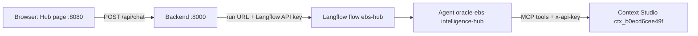

# Demo Guide: Playground plus the Hub Page

How to show the client the agent and the real application side by side. No secrets are stored here.

## 1. What can and cannot be done

| Question | Answer |
|---|---|
| Can the agent open the HTML page? | No. The Playground only shows text. It cannot render or launch `oracle-ebs-intelligence-hub.html`. |
| How does the page get the bot? | The page has its own chat tab. It calls the local backend (`/api/chat`), the backend calls the Langflow workflow, and the workflow runs the same agent you test in the Playground. |
| What does the client see? | Two windows: Agent Studio Playground (the agent and its Tool Trace) and the Hub page (7 tabs plus the assistant inside the Chat tab). |

If the backend or workflow is not reachable, the Chat tab falls back to its local answers. The badge in the Chat tab shows **ICA Live** or **ICA Offline**.

## 2. One-time setup on the demo machine

1. Run `setup-venv.bat` (creates `venv` and installs `backend/requirements.txt`).
2. Run `configure-secrets.bat`. It asks, with hidden input, for:
   - **Langflow workflow run URL**: Agent Studio -> flow `ebs-hub` -> the flow's API pane -> copy the run URL.
   - **Langflow API key**: Agent Studio -> Settings -> Langflow API Keys.
   - MCP bearer token and Context Studio API key (optional in agent mode; the agent holds its own key).
3. The script writes `backend/.env`, which is git-ignored. Press Enter at a prompt to keep the existing value.
4. Run `start-all.bat`. It starts the backend on `127.0.0.1:8000`, the page on `127.0.0.1:8080`, and opens the page.
5. Check `http://localhost:8000/health`. `ica_configured` must be `true`.

## 3. Demo flow

Arrange two windows side by side: Playground on the left, Hub page on the right.

| Step | Where | Do | Show |
|---|---|---|---|
| 1 | Playground | `List the available contexts.` | `ctx_b0ecd6cee49f` and the Tool Trace |
| 2 | Playground | `Review this SQL: select * from ap_invoices_all` | The ORG_ID rule and the SELECT * rule, with the tool used |
| 3 | Hub page | Log in as **Technical**; passwords are in your local `ebs-credentials.js` | 7 tabs visible |
| 4 | Chat tab | Same question as step 2 | Badge **ICA Live**; the same answer inside the page |
| 5 | Reports | Open AP -> Aged Payables Detail; try charts and CSV/Excel/PDF export | 26 reports across 7 modules |
| 6 | SQL Advisor | Paste the SQL; run Performance, Code Review (27 checks) and Formatter | Findings and quality score |
| 7 | Doc Generator | Fill the form; generate a TDD or FSD | Document with 4 diagrams |
| 8 | SQL Lab | Type "unpaid invoices over 10000" | Generated SQL; out-of-scope request rejected |
| 9 | Academy | Open a module; use Ask Assistant | Functional and technical views, flowchart |
| 10 | Data Connect | Upload an Excel/CSV; auto-map; push to a report | Your data shown in a report |
| 11 | Login as **Employee** | Reload and choose Employee | Only Chat, Reports and Data Connect |

The Employee role shows 3 tabs; the Technical role shows all 7.

### Questions a client would actually ask

Use plain business questions in steps 2 and 4. Do not ask for rule IDs such as COMP-008; the agent finds the rule itself.

- `Review this SQL: select * from ap_invoices_all`
- `Why should SELECT * be avoided in production queries?`
- `Which tables need an ORG_ID filter?`
- `Which reports cover overdue supplier invoices?`
- `Which column holds the supplier name?`
- `Walk me through the procure-to-pay process.`

Avoid tables that are not in the knowledge graph (for example `AP_INVOICE_LINES_ALL`). The agent will say it found nothing, which is correct, but it is a weak demo moment.

### Before you present (10 minutes ahead)

1. Open the `ebs-hub` flow in Langflow and send `Hi` in the Playground. It should answer in a few seconds.
2. Run `test-ica.bat`. Tests 2 to 5 should show `"source":"ica_live"`.
3. Press Ctrl+F5 on the Hub page and check the badge says **ICA Live**.

## 4. If something fails

| Symptom | Fix |
|---|---|
| Badge says ICA Offline | Backend not running. Run `start-all.bat`. |
| `/health` shows `ica_configured: false` | `ICA_WORKFLOW_URL` or `ICA_API_KEY` missing in `backend/.env`. Run `configure-secrets.bat`. |
| Chat answers look generic | Local fallback is answering. Check `ica_configured`, then the backend window for the error. |
| Playground says `Invalid token` | Re-paste the Context Studio key in the agent instructions. See `CONTEXT_STUDIO_AGENT_SETUP.md`. |
| Reply says `Session mint failed (401) ... "exp" claim` | The Langflow session token expired. Close and reopen Langflow, or refresh the `ICAAAS_BACKEND_TOKEN` global variable, then send `Hi` in the Playground. A new Langflow API key does not fix this. |
| Page asks for CORS or cannot call the backend | Open the page from `http://localhost:8080`, not by double-clicking the file. |

## 5. Showing it to a client who cannot reach your machine

The page and backend run on `127.0.0.1` only, so share your screen. To host them for others, the backend would need to run on a hosted service (for example IBM Cloud Code Engine) with its secrets held as service secrets and authentication in front of it. That is a separate piece of work; do not expose the local servers on `0.0.0.0`.
